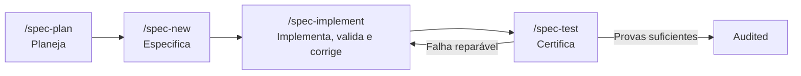

<div align="center">

**🌐 Idioma:** Português | [English](docs/i18n/README.en.md) | [Español](docs/i18n/README.es.md) | [简体中文](docs/i18n/README.zh-Hans.md) | [हिन्दी](docs/i18n/README.hi.md)

</div>

<br/>

<div align="center">
<br/>
<br/>
<p align="center">
  
</p>
<h1>DsCode</h1>

[![][github-license-shield]][github-license-link]
[![][github-stars-shield]][github-stars-link]

**Assistente de programação no terminal, com suporte a múltiplos modelos e ferramentas de desenvolvimento orientado a especificações.**

<br/>
</div>

O **DsCode** é um assistente de programação que roda no terminal. Ele integra modelos de diferentes provedores — como DeepSeek, OpenAI, Anthropic, Gemini, GLM, Muse Spark e modelos locais — para analisar, revisar e escrever código no projeto. Os modelos disponíveis dependem da configuração e da versão instalada.

O DsCode oferece ferramentas de planejamento orientado a especificações (SDD), implementação, validação e auditoria. A arquitetura SDD v21 integra essas capacidades em **um ciclo único de engenharia**, no qual erros de compilação e testes retornam ao mesmo executor até a correção, dentro de limites seguros. A certificação permanece determinística e depende de evidências reais; o agente não aprova suas próprias alterações. O motor v21 está ativo; a homologação de ponta a ponta em um `/spec-pipe` real segue pendente.

---

## Principais capacidades



> **Estado de implantação:** o ciclo com retorno automático do `spec-test` à implementação está implementado e coberto por testes determinísticos. A homologação de ponta a ponta em um `/spec-pipe` real permanece pendente; até lá, a execução pode terminar com trabalho parcial preservado e certificação pendente. Consulte [o contrato v21](sdd-contrato/sdd-fluxo.md). Não confunda código escrito com spec certificada.

**Política de qualidade prevista:** continuar implementação e correção quando houver trabalho seguro; pausar quando recursos ou segurança exigirem; declarar `audited` apenas com aceitação verificada. Falhas reais não são ocultadas.


| Capacidade | O que faz | Por que nenhum outro tem |
|---|---|---|
| **Pipeline SDD** | Planejar → especificar → implementar → testar | v21: um ciclo de implementação e correção com certificação baseada em provas |
| **Multi-provedor** | DeepSeek V4/V4.1, OpenAI GPT, Anthropic Claude, Google Gemini, Z.AI GLM, Muse Spark, Ollama/vLLM local | Troque de provedor sem alterar uma linha de configuração; chaves por projeto, migração automática |
| **Stack-agnostic** | TypeScript, .NET, Python e mais pelo mesmo caminho de validação | O gate não julga sua linguagem — valida o documento e roda seus testes |
| **Skills como agentes** | Subagentes isolados com modelo, tools e thinking próprios | Cada skill roda em sandbox — não polui o contexto principal |
| **MCP nativo** | Conecte bancos, navegadores e APIs externas | Integrado nas 3 camadas: skills, specs e TUI |
| **Steering** | Regras persistentes que a IA segue em todas as sessões | Controle granular: adicione, liste, altere e remova regras por posição |

---

## Estado da reforma SDD

Descrição e estado: a v21 substitui a lógica de etapas rígidas por um ciclo único capaz de detectar erros reais, transmitir diagnósticos completos (stdout e stderr) e corrigir o software dentro da mesma execução. O motor v21 está ativo e homologado nos gates determinísticos (`check`, `build` e suíte afetada) e em cenários de ponta a ponta isolados — inclusive quando `spec-test` reprova depois de todas as tarefas originais estarem concluídas: o mesmo executor recebe uma unidade de correção, corrige e a certificação é reexecutada com gates reais. Specs reais não foram reexecutadas nem mutadas. Contrato v20 parseável continua suportado; o contrato v21 ativo é declarado em modo `v21-guidance`.

---

## Instale em 30 segundos

Baixe o binário na **[página de releases](https://github.com/andrelncampos/dscode-public/releases)**. O `package.json` do snapshot examinado declara **[Node.js 24+](https://nodejs.org)**. A homologação-alvo da reforma é **Node.js 26**, mas a alteração do requisito mínimo depende de decisão e validação separadas.

| Sistema | Arquivo |
|---|---|
| Windows (x64) | `dscode-windows-x64.zip` |
| Linux (x64) | `dscode-linux-x64.tar.gz` |
| macOS (Apple Silicon) | `dscode-macos-arm64.tar.gz` |

Extraia e execute `./dscode`. O DsCode verifica atualizações automaticamente ao iniciar.

---

## Primeiro uso

### 1. Configure sua chave

Rode `dscode` dentro do projeto e use `/model-add`. O wizard testa o modelo e grava a credencial **cifrada** em `.dscode/settings.json` — nunca em texto puro.

O arquivo é sempre do projeto; não existe camada global:

```json
{
  "model": "deepseek-flash",
  "modelInstance": "minha-instancia",
  "modelInstances": {
    "minha-instancia": {
      "name": "minha-instancia",
      "modelId": "deepseek-flash",
      "provider": "deepseek",
      "apiKey": "aes256:...",
      "apiKeyEncrypted": true,
      "priority": 1
    }
  }
}
```

Sem modelo configurado, o DsCode abre normalmente e mostra um aviso persistente guiando para `/model-add`. Chaves ausentes usam o default.

### 2. Abra seu projeto e inicie

```bash
cd /caminho/do/seu/projeto
dscode
```

### 3. Faça o tour interativo

Digite `/quickstart` para um tour de 5 minutos. O tour apresenta os comandos e um projeto de exemplo. A conclusão automática das specs depende do comportamento da versão instalada.

Ou execute `dscode --quickstart` para pular direto para o tour.

---

## Configuração

O `settings.json` é **esparso**: só o que você declarar existe; todo o resto usa o default. Ele fica em `.dscode/settings.json`, é ignorado pelo Git e não pode ser alterado por um turno da IA.

| Chave | Para que serve | Exemplo |
|---|---|---|
| `model` / `modelInstance` | Modelo ativo e instância fixada | `"deepseek-flash"` |
| `modelInstances` | Credenciais cifradas, provider e prioridade de failover | veja acima |
| `maxTokens` | Teto de tokens de saída | `128000` |
| `reasoningEffort` | Profundidade de raciocínio | `"max"` |
| `permissions` | `allow` / `deny` / `ask` / `defaultMode` por escopo | `{"deny":["mutate-git-log"]}` |
| `trust.tools` | Aprovação persistente de uma ferramenta | `{"bash":{"approved":true}}` |
| `trustedReadRoots` | Diretórios externos somente leitura | `["/srv/docs"]` |
| `mcpServers` | Servidores MCP | veja [docs/mcp.md](docs/mcp.md) |
| `memory` | Retenção e limites do histórico | `{"recentTurns":10}` |
| `budget` | Alerta de custo diário/mensal (não bloqueia) | `{"dailyLimit":5}` |
| `sdd.profile` | Perfil de roteamento do SDD | `"economic"` |
| `sdd.validationExecution` | Autoriza validação no host | `{"allowTrustedLocalExecution":true}` |
| `sdd.autonomousCorrection` | Correção autônoma no `/spec-pipe` | `true` |
| `cacheMode` | Consciência de cache de prefixo | `"strict"` |
| `terminalTitleTemplate` | Título do terminal | `"{{cwd}}"` |
| `locale` | Idioma da interface | `"pt"` |

**Referência completa:** [docs/configuration.md](docs/configuration.md) — tipo, default e efeito das 77 chaves, os sub-schemas (`modelInstances`, `modelPricing`, `mcpServers`, `engineEscalation`, `sdd.validationExecution`), precedência e receitas. As chaves menos usadas no dia a dia (flags `openai*`, governança SDD, custo, memória detalhada, MCP) ficam lá, não aqui.

---

## Exemplos do que você pode fazer

| Tarefa | Digite no prompt |
|---|---|
| **Entender um projeto** | "Explique a arquitetura deste projeto em 3 frases." |
| **Revisar código** | "Revise as alterações do último commit antes de eu fazer push." |
| **Implementar feature** | "Adicione validação de email ao formulário em `src/form.ts`." |
| **Refatorar** | "Simplifique a função `processData()` sem mudar o comportamento." |
| **Investigar bug** | "Analise este stack trace e encontre a causa." |
| **Criar testes** | "Crie testes unitários para `validateUser()` em `src/validators.ts`." |
| **Planejar features** | `/spec-plan` — descreva o que quer e a IA cria specs completas. |
| **Criar regras** | `/steering-add sempre use português para responder` |

---

## Comandos essenciais

Digite `/` no prompt para ver o menu completo. Aqui estão os que você mais vai usar:

| Comando | Descrição |
|---|---|
| `/new` | Nova conversa — zera o contexto |
| `/model` | Trocar entre 44 modelos (DeepSeek, OpenAI, Anthropic, Gemini, GLM, Muse Spark, locais) |
| `/model-add` | Cadastrar modelo pelo wizard unificado (testa antes de salvar) |
| `/quickstart` | Tour interativo de 5 minutos pelo pipeline SDD |
| `/spec-plan` | Planejar novas funcionalidades com specs |
| `/spec-pipe <n>` | Pipeline completo: new → implement → test |
| [`/spec-test`](docs/spec-test.md) | Executar testes canônicos do projeto para Node/TypeScript, Go, Java e Rust |
| `/init` | Criar `AGENTS.md` com instruções para a IA |
| `/steering-add` | Adicionar regra que a IA segue em todas as sessões |
| `/budget` | Ver custo acumulado do projeto por modelo e timezone |
| `/context` | Ver tokens, custo e cache da sessão |
| `/docs` | Consultar documentação técnica atualizada (Exa/Google) |
| `/sdd` | Configurar o pipeline SDD (depth, cascade) sem editar JSON |
| `/help` | Lista completa de comandos e atalhos |

> 📋 [Lista completa dos 52 comandos](https://github.com/andrelncampos/dscode-public#todos-os-comandos-slash) — incluindo gestão de modelos, notas, MCP e skills.

---

## Skills e agentes autônomos

Skills são guias em Markdown que ensinam a IA a trabalhar de um jeito específico. O DsCode carrega skills de 3 fontes:

| Local | Uso |
|---|---|
| `templates/skills/` (built-in) | 5 skills sempre disponíveis |
| `~/.agents/skills/<nome>/SKILL.md` | Skills pessoais |
| `./.agents/skills/<nome>/SKILL.md` | Skills do projeto |

Skills podem rodar como **agentes autônomos** (`mode: agent`) — cada um com seu próprio modelo, ferramentas e thinking, executando em sandbox sem poluir o contexto principal.

```yaml
# Exemplo: .agents/skills/reviewer/SKILL.md
name: reviewer
description: Revisa código em busca de bugs
mode: agent
model: deepseek-flash
tools: [Read, Grep, Glob, Bash]
```

---

## Segurança

| Prática | Por quê |
|---|---|
| **Revise comandos antes de permitir** | A IA pode sugerir `rm`, `sudo` ou acesso à rede |
| **Faça commit antes de tarefas grandes** | `git reset --hard` desfaz tudo se algo der errado |
| **Revise os diffs** | O DsCode mostra cada alteração — a IA pode errar |
| **Nunca comite `settings.json`** | Contém sua chave de API (o `.gitignore` já exclui) |
| **Use branch separada para experimentos** | `git checkout -b experimento-ia` antes de mudanças arriscadas |

---

## Licença e origem

**DsCode é distribuído sob a licença MIT.** Os binários e demais artefatos públicos podem ser usados, copiados, redistribuídos, modificados, sublicenciados e vendidos sem cobrança de royalties — para uso pessoal, acadêmico, profissional ou comercial.

DsCode é um software de código-fonte fechado com distribuições executáveis disponibilizadas sob a licença MIT. O código-fonte das modificações específicas do DsCode não integra a distribuição pública. Por esse motivo, o DsCode não é apresentado como software de código aberto.

**Permissões da MIT (binários distribuídos):**
- ✅ Uso pessoal, acadêmico, profissional e comercial
- ✅ Redistribuição e espelhamento
- ✅ Sublicenciamento e venda
- ✅ Inclusão em produtos e artefatos científicos
- ✅ Benchmarking e publicação de resultados
- ✅ Modificação do artefato distribuído, quando tecnicamente possível

Este projeto deriva de [DeepCode (lessweb/deepcode-cli)](https://github.com/lessweb/deepcode-cli), originalmente licenciado sob MIT. O aviso de copyright original é preservado em [LICENSE](LICENSE) e [NOTICE](NOTICE). Consulte [THIRD_PARTY_NOTICES.md](THIRD_PARTY_NOTICES.md) para a relação completa de componentes e licenças.

---

## Canais oficiais

| Canal | Link |
|---|---|
| **GitHub** | [github.com/andrelncampos/dscode-public](https://github.com/andrelncampos/dscode-public) |
| **Releases** | [github.com/andrelncampos/dscode-public/releases](https://github.com/andrelncampos/dscode-public/releases) |
| **Issues** | [github.com/andrelncampos/dscode-public/issues](https://github.com/andrelncampos/dscode-public/issues) |

⚠️ Instale o DsCode **apenas** pelos canais oficiais acima. Não confie em versões de sites de terceiros.

---

<!-- LINK GROUP -->

[github-license-link]: https://github.com/andrelncampos/dscode-public/blob/master/LICENSE
[github-license-shield]: https://img.shields.io/github/license/andrelncampos/dscode?color=4d6BFE&labelColor=black&style=flat-square
[github-stars-link]: https://github.com/andrelncampos/dscode-public/stargazers
[github-stars-shield]: https://img.shields.io/github/stars/andrelncampos/dscode?color=yellow&labelColor=black&style=flat-square
